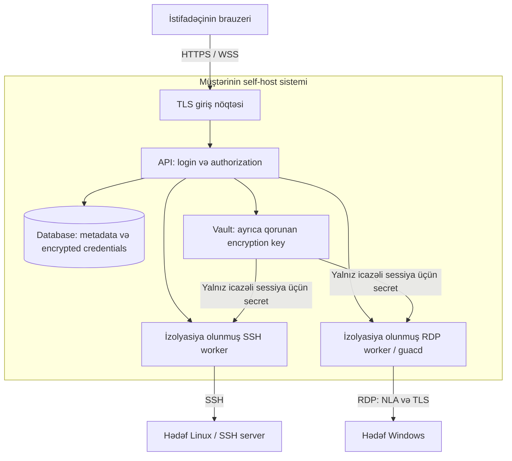

# Keybash — self-host SSH/RDP məhsul planı

Tarix: 12 oktyabr 2026, Asia/Baku. Versiya: 0.1.

Status: istifadəçinin qəbul etdiyi ilkin məhsul və təhlükəsizlik planı. Ad: Keybash. İnkişaf private başladı; GitHub Free branch protection məhdudiyyətinə görə istifadəçi public repository-yə keçidi təsdiqlədi. İşlək SSH/RDP məhsulu və deployment hələ hazır deyil. Qərarlar sübut və istifadəçi yönləndirməsinə görə yenilənəcək.

## 1. Məqsəd və razılaşdırılmış sərhədlər

Fərdlər və kiçik komandalar öz SSH açarlarını və SSH/RDP hesablarını bir yerdə təhlükəsiz saxlasın, serverlərinə brauzerdən qoşulsun və gündəlik işi rahat görsün.

Prioritet sırası: təhlükəsizlik → terminal/RDP rahatlığı → funksiyaların genişliyi. Rahatlıq təhlükəsizlik qərarları ilə birlikdə layihələndiriləcək.

- Məhsul yalnız self-host olacaq. Denyfirst cloud hesabı, relay və ya mərkəzi credential saxlama tələb olunmayacaq.
- Müştəri öz infrastrukturunu, açarlarını, backup-larını və şəbəkə çıxışını idarə edəcək.
- Gündəlik istifadə üçün brauzer kifayət edəcək. İlkin server quraşdırması administrator işi olacaq.
- PAM approval, avtomatik hesab discovery-si, privileged credential rotation və command interception məhsulun əhatəsinə daxil deyil.
- Porch və Rootwell-ə dəyişiklik edilməyəcək. Lazım olduqda yalnız oxuma. Yeni məhsul ayrı qovluq və ayrıca repository-də inkişaf etdiriləcək.
- Login-dən sonra tətbiq xidmətlərinə çıxış verilir; backend hər əməliyyatın icazəsini ayrıca yoxlayır. Səhifələri gizlətmək authorization hesab edilmir.
- Vizual istiqamət: Denyfirst ailəsinə uyğun neytral qara, ölçülü qırmızı vurğu, sistem şrifti, rahat oxunaqlılıq və görünən klaviatura fokusu.

Bu sənəddəki stack, vault modeli, timeout rəqəmləri və mərhələ bölgüsü ilkin təklifdir. Məhsulun yuxarıdakı sərhədləri istifadəçinin təsdiqlədiyi istiqamətdir.

## 2. İstifadəçi üçün əsas nəticə

"Açarım haradadır, hansı hesabla girirdim, hansı proqramı açmalıyam?" problemi aradan qalxsın.

Adi yol: login və MFA → serveri axtar/seç → Connect → terminal və ya masaüstündə işlə. Təhlükəsizliyə görə lazım olan server kimliyi yoxlaması və ya əlavə autentifikasiya aydın izahla göstərilir.

İlk versiya şəxsi connection və credential-lara əsaslanacaq. Bir self-host instansiyada bir neçə hesab ola bilər; hər hesab öz resurslarını görür. Komanda paylaşımı hələ təsdiqlənməyib və ayrıca dizayn tələb edir. Administratorun hesab idarəetməsi normal interfeysdə başqasının secret-larını göstərməməlidir.

## 3. Üçüncü tərəf komponentləri və lokal işləmə

"Üçüncü tərəf kodu" ilə "xarici xidmət" fərqli anlayışlardır. Guacamole və xterm.js başqa layihələrin açıq mənbə kodudur. Onları paketimizə daxil edib müştərinin infrastrukturunda işlədə bilərik.

| Komponent | Harada işləyəcək | Rolu |
|---|---|---|
| Bizim frontend | Müştərinin serverindən brauzerə yüklənəcək | Login, connection, credential və workspace interfeysi |
| xterm.js | İstifadəçinin brauzerində | Terminal ekranı və klaviatura girişinin emulyasiyası; özü SSH bağlantısı qurmur |
| SSH worker | Müştərinin serverində | Hədəf serverə SSH bağlantısı və remote PTY açır |
| Guacamole JS client | Brauzerdə, lokal paketdən | RDP görüntüsü və input üçün protokol müştərisi |
| guacd / RDP worker | Müştərinin serverində | RDP-ni brauzer üçün uyğun axına çevirir |
| API və vault | Müştərinin serverində | Autentifikasiya, icazələr, credential saxlama və sessiya idarəsi |
| Database | Müştərinin serverində | Şifrələnmiş secret-lar və tətbiq metadatası |

Bizim brend və xüsusi interfeys göstəriləcək. Açıq mənbə lisenziyaları və tələb olunan bildirişlər paketdə saxlanılacaq; komponentlərin mənşəyi sənədlərdə aydın olacaq.

Runtime-da xarici CDN, font, analytics, crash upload, cloud auth və lisenziya yoxlama xidməti nəzərdə tutulmur. Quraşdırma/yeniləmə zamanı paketlərin əldə edilməsi gündəlik işdən ayrıdır; offline paket yolu hazırlanmalıdır. Air-gap işləmə ayrıca egress testindən sonra iddia edilə bilər.

## 4. İlkin arxitektura

Brauzer hədəfə birbaşa TCP bağlantısı qurmur. Self-host serverin hədəfə şəbəkə yolu olmalıdır. LAN, müştərinin VPN-i və ya öz VPS-i istifadə oluna bilər; məhsul öz cloud relay-ini tələb etməyəcək. Hədəfdə mövcud SSH/RDP xidməti lazımdır; ilk versiyada ayrıca agent quraşdırılması nəzərdə tutulmur.

İlkin texniki namizədlər: TypeScript/React frontend, Go API/SSH servisi, PostgreSQL, xterm.js və RDP üçün guacd. Bunlar prototipdə yoxlanıb ayrıca qərar sənədində dəqiqləşdiriləcək.
15 oktyabr qərarı: ilk tək-proses Linux custody lab-ı PostgreSQL yerinə ayrıca
xidmət tələb etməyən bbolt istifadə edir; instance key ayrıca saxlanır. Səbəb
və məhdudiyyətlər `adr/0004-durable-local-custody.md`-dədir. SSH/RDP protokollarını sıfırdan yazmaq nəzərdə tutulmur.

Guacamole-un hazır Java web tətbiqini istifadə etmək məcburi deyil. Öz API-miz ilə JS client/guacd inteqrasiyasının çətinliyi və təhlükəsizliyi sınaqda qiymətləndiriləcək. Hər iki bağlantı yolunda eyni authorization qaydaları işləməlidir.

## 5. Təhlükəsizlik modeli və etibar sərhədi

Qorunan məlumat: private key, passphrase, remote password, MFA seed, recovery məlumatı, sessiya tokenləri, connection metadata və terminal/RDP giriş-çıxışı.

Etibar edilən hissələr: müştərinin host administratoru, bizim API/vault və sessiya worker-ləri, paylanan proqram kodu və istifadəçinin brauzeri. Hədəf serverdən gələn mətn və protokol məlumatı etibarsız girişdir.

Server-side gateway credential-ı bağlantı qurmaq üçün istifadə edə bilir və sessiya məlumatını emal edir. Bazanın şifrələnməsi canlı host tam ələ keçirildikdə credential-ları qoruduğumuz mənasına gəlmir. Bu model zero-knowledge deyil. Zərərli brauzer extension-u və tam kompromis olunmuş endpoint də etibar sərhədindən kənardadır.

| Təhdid | Layihələndirilən nəzarət | Qalan sərhəd |
|---|---|---|
| Database/backup oğurlanması | Authenticated encryption, açarın bazadan ayrılması, encrypted export | Açar da əldə olunarsa qoruma itir |
| Başqa hesabın resursuna çıxış | Serverdə ownership yoxlaması, ayrı credential/session icazələri | Host administratoruna qarşı kriptoqrafik izolyasiya iddiası yoxdur |
| Saxta hədəf server / MITM | SSH host key və RDP certificate verification | İlk etibar qərarı düzgün verilməlidir |
| XSS / sessiya oğurlanması | CSP, lokal asset-lər, təhlükəsiz DOM, server sessiyaları | Etibarsız browser extension-u ayrıca riskdir |
| Şəbəkədə icazəsiz keçid | Qeydiyyatdan keçmiş hədəflər, egress məhdudiyyəti, dial-time yoxlama | İcazəli remote hesabın öz səlahiyyətləri qalır |
| Protokol worker-inin kompromisi | Minimum səlahiyyət, sandbox, ayrıca DB/key çıxışı verilməməsi | Worker öz aktiv sessiyasının məlumatını emal edir |

### Credential və vault

- Connection və credential ayrı obyektlərdir. Bir credential icazəli bir neçə connection-a bağlana bilər; credential dəyişəndə təsirlənən connection-lar göstərilir.
- İlkin vault təklifi: hər qeyd üçün təsadüfi data key; AEAD ilə şifrələmə; data key ayrıca instance key ilə qorunur. Kriptoqrafik kitabxana istifadə olunur, öz crypto alqoritmimiz yazılmır.
- Şifrələnmiş qeydin owner/record/version məlumatı ilə bağlılığı yoxlanır; başqa qeydə ciphertext köçürmə hücumları test edilir.
- Instance key repoda, Docker image-də, database-də və DB backup-ında saxlanılmır. Məhdud icazəli ayrıca secret mount və ayrıca recovery nüsxəsi nəzərdə tutulur.
- Worker bütün vault-u açmaq imkanına malik deyil. Yalnız konkret icazəli sessiyanın lazım olan credential-ını alır. Plaintext secret-ların ömrü minimuma endirilir; RAM-dan zəmanətli silinmə iddiası verilmir.
- Secret-lar URL, process argument, ümumi environment dəyişəni, clipboard, log və browser storage-da saxlanılmır. İmport məzmunu yaddaşda yoxlanır; diskə müvəqqəti private key yazılması standart yol deyil.
- Secret reveal və plaintext export ayrıca owner icazəsi və təkrar autentifikasiya tələb edir. UI standart olaraq adı, tipi və fingerprint-i göstərir.
- Login password-u ilə remote password fərqləndirilir. Login password-u geri açılan şifrələmə ilə yox, müasir password hashing ilə saxlanılır.

### Login və sessiyalar

- Lokal hesablar, password + TOTP MFA və birdəfəlik recovery code-lar ilkin təklifdir. Xarici email və identity provider gündəlik iş üçün lazım deyil.
- Passkey əlavə namizəddir; RP/domain və backup qaydaları həll olunmadan əsas tələb sayılmır. Phishing müqaviməti TOTP ilə passkey üçün eyni iddia edilmir.
- Bootstrap yalnız lokal administratora verilən birdəfəlik secret ilə; default password və açıq public registration yoxdur.
- Secure/HttpOnly/SameSite cookie, CSRF qoruması, login rate limit və session fixation qoruması.
- WebSocket upgrade-də authentication və dəqiq Origin yoxlaması. Sessiya konkret istifadəçi/connection-a bağlanır; bilet tələb olunarsa qısaömürlü, birdəfəlik və URL-də olmayan ötürmə yolu seçilir.
- Hər API-də icazə yoxlanır. Aktiv socket-lərdə expiry və revocation da tətbiq edilir; login yoxlaması yalnız socket açılan anla məhdudlaşmır.
- Logout, istifadəçinin deaktiv edilməsi və icazənin ləğvi worker-i dayandırmalıdır. İlkin qəbul hədəfi: revocation-dan sonra 5 saniyə ərzində tətbiq sessiyasının bağlanması.
- İlkin siyasət: 15 dəqiqə idle və 8 saat absolute session müddəti; administrator tənzimləyə bilir. Təkcə davamlı server output-u istifadəçi fəaliyyəti hesab edilmir.
- Tətbiq bağlantısını bağlamaq hədəfdəki bütün prosesləri öldürmək zəmanəti deyil. SSH-də tmux/nohup və Windows disconnected session davranışı ayrıca izah ediləcək.

### Hədəfə bağlantı və servis izolyasiyası

- İlk SSH bağlantısında fingerprint ayrıca kanal vasitəsilə təsdiqlənir. Dəyişmiş fingerprint avtomatik qəbul olunmur; connection bloklanır və yenidən yoxlama tələb olunur.
- RDP üçün NLA və TLS, CA/hostname yoxlaması. Öz CA-sı olan müştəri onu import edə bilər; sabit fingerprint trust modeli sınaqda qiymətləndirilir. Blanket certificate-ignore seçimi standart həll deyil.
- LAN/private IP-lər məhsulun əsas istifadəsidir və ümumi şəkildə bloklanmır. Administratorun icazə verdiyi subnet/host/port-lar daxilində qeydiyyatdan keçmiş connection-lar işləyir.
- Cloud metadata, loopback, link-local və məhsulun DB/control servislərinə keçid standart olaraq rədd edilir. DNS nəticəsi və faktiki dial edilən ünvan eyni siyasətlə yoxlanır; IPv4/IPv6, rebinding və guacd-nin yenidən DNS həlli nəzərə alınır.
- Worker-lər hostda lokal shell açmır və istifadəçiyə Docker host terminalı vermir. SSH remote PTY istifadə edir. Docker socket, privileged mode və lazımsız host mount yoxdur.
- guacd öz authentication mexanizminə malik deyil. Onun portu public/LAN-a publish edilmir; yalnız gateway-in çatdığı ayrıca şəbəkədə qalır. Hostlararası yerləşdirmə ayrıca təhlükəsiz transport tələb edir.
- Minimum UID/capability, resurs limitləri, timeout və mümkün olduqda read-only filesystem. Sandbox və egress nəzarətinin Linux deployment-də faktiki işləməsi test edilir.

## 6. Terminal və RDP rahatlığı

### SSH

Seçim/copy, paste shortcut-u, sağ klik, scrollback, search, font ölçüsü, tablar, fullscreen, remote PTY resize və bağlantı statusu.

Ctrl+C əmri dayandırmaq funksiyasını saxlayır; copy üçün Ctrl+Shift+C və uyğun platforma qaydası göstərilir. Tab, Ctrl+D, Esc, oxlar, vim/nano/htop/tmux və Azərbaycan Unicode mətnləri real shell-də test edilir.

Çoxsətirli və idarəedici simvolları olan paste üçün görünən preview verilir. Bracketed paste dəstəyi düzgün istifadə edilir, amma bütün shell-lərdə gözlənilməz icranı dayandırdığı iddia edilmir. Paste-ə ayrıca Enter əlavə edilmir.

Terminal title/link və escape sequence-ləri etibarsız girişdir. OSC clipboard əməliyyatları istifadəçi hərəkəti olmadan lokal clipboard-u dəyişməməlidir. Tətbiq terminal çıxışını raw HTML kimi render etmir.

### RDP

İlk versiyada mətnin lokal → remote və remote → lokal copy/paste-i, ölçü dəyişməsi, fullscreen, keyboard layout seçimi və xüsusi düymə göndərmə paneli.

Clipboard icazəsi varsa birbaşa əməliyyat, yoxdursa sadə lokal Copy/Paste paneli. Clipboard yalnız nəzərdə tutulan sessiyaya ötürülür; bütün açıq tablara avtomatik yayılmır. Tətbiq clipboard tarixçəsini saxlamır və loglamır. Sessiya bağlananda daxili buffer təmizlənir; əməliyyat sisteminin clipboard tarixçəsinin silindiyi iddia edilmir.

Brauzer/OS bəzi shortcut-ları özü idarə edir. Fayl və şəkillərin clipboard ilə ötürülməsi, audio, printer, webcam və disk redirection ilk buraxılışın qəbul şərti deyil.

Brauzer matrisi: Chrome, Edge, Firefox və Safari; Windows/macOS/Linux keyboard fərqləri. İlk texniki sınaq Chrome/Edge üzərində başlaya bilər, tam dəstək yalnız ayrıca yoxlanmış matrisi əhatə edər. Mobil connection idarəsi nəzərdə tutulur; desktop səviyyəli mobil terminal/RDP rahatlığı ayrıca mərhələdir.

## 7. İlk işlək versiyanın funksiyaları

| Bölmə | Əhatə |
|---|---|
| Connections | SSH/RDP, host, port, username/credential bağlantısı, RDP domain, qovluq, etiket, favorit, axtarış |
| Credentials | OpenSSH private key importu, passphrase, password; fingerprint, ad, təsirlənən connection-lar |
| Workspace | SSH/RDP tabları, copy/paste, fullscreen, ölçü, aydın xəta və disconnect |
| Hesab | MFA, recovery code-lar, aktiv login sessiyaları və ləğv |
| Backup | Şifrələnmiş export, ayrıca key recovery təlimatı, təmiz sistemə restore |
| Administrasiya | Hesab idarəsi, target şəbəkə siyasəti, timeout, local audit və versiya məlumatı |

Secret import/export üçün format, ölçü limiti və ownership yoxlaması; UI xəta mesajlarında secret məzmunu göstərilmir. Private key passphrase-inin hər bağlantıda soruşulması alternativi də saxlanıla bilər.

Local audit yalnız login, connection başlama/bitmə, credential dəyişmə/export və administrativ hadisələr üçün məhdud metadata saxlayır. Keystroke, terminal output, clipboard və sessiya videosu standart olaraq yazılmır. Audit read icazəsi və retention ayrıca siyasətdir; host adminə qarşı dəyişdirilməzlik iddiası yoxdur.

Sonrakı namizədlər: komanda paylaşımı, SSH bastion/jump host, SFTP fayl paneli, mövcud vault-lardan import, passkey və daha geniş cihaz dəstəyi. Bunlar ilkin versiyanın təhlükəsizlik/rahatlıq yoxlamasını gecikdirməməlidir.

## 8. Quraşdırma, yeniləmə və bərpa

İlkin deployment: müştərinin Linux hostunda Docker Compose. Server resursları və paralel sessiya limiti load test nəticəsinə görə elan olunacaq; hələ minimum RAM/CPU vəd edilmir.

20 oktyabr qərarı: ilk SSH xidmət inteqrasiyası native Linux systemd/cgroup-v2
source plan ilə sınanır (`LINUX-SERVICE-LAB.md`). Ayrıca root manager-in namespace
qurması və gateway-in root olmaması konteynerə geniş host səlahiyyətləri vermədən
yoxlanır. Compose ilkin namizəd idi; hazır konteyner/quraşdırıcı iddiası yoxdur.

Public-facing giriş yalnız HTTPS-dir; private CA və ya müştərinin certificate-i ilə lokal HTTPS mümkündür. Public CA/ACME seçilərsə onun xarici şəbəkə ehtiyacı ayrıca göstərilir. DB və guacd portları publish edilmir.

Paketə frontend asset-ləri, protokol komponentləri və lazımi runtime daxil edilir. Versiyalar pin edilir; imzalanmış release, checksum, dependency inventarı/SBOM və yeniləmə təlimatı hazırlanır. Offline paket ayrıca paylana bilər; gündəlik işləmə internetə çıxış olmadan test olunur.

Backup database, qorunmalı metadata və versiya manifestini əhatə edir. Decryption key ayrıca backup-lanır; eyni archive-ə plaintext əlavə edilmir. Export ayrıca passphrase ilə qoruna bilər. Restore bələdçisi açarların və instance identifikatorunun təhlükəsiz köçürülməsini əhatə edir.

Login recovery ilə vault key recovery fərqli proseslərdir. İtmiş instance key-in recovery nüsxəsi yoxdursa, saxlanmış credential-ları geri açmaq mümkün olmayacaq. Bu məsələ onboarding-də praktik olaraq izah edilir.

Upgrade-dən əvvəl backup, schema migration və köhnə versiyaya qayıtmanın məhdudiyyətləri sənədləşdirilir. Bir düymə ilə bütün migration-ların geri çevrildiyi vəd edilmir. Denyfirst-ə avtomatik diagnostic upload yoxdur; istifadəçi istəsə redaktə edilmiş support bundle export edə bilər.

## 9. İş mərhələləri və çıxış şərtləri

| Mərhələ | Nəticə | Keçid şərti |
|---|---|---|
| 0 — Plan | Məhsul sərhədi, threat model, ad namizədləri | Self-host və etibar sərhədi aydındır; açıq seçimlər qeyd olunub |
| 1 — Texniki sınaq | Ayrıca laboratoriyada minimal SSH + RDP, yalnız test credential-ları | Clipboard, keyboard, certificate/host-key və lokal işləmə ölçülüb; stack qərarı yazılıb |
| 2 — Təhlükəsizlik təməli | Login/MFA, vault, ownership, session lifecycle, worker isolation | Hesablararası çıxış və revocation testləri keçir |
| 3 — Məhsul axını | Connections, credentials, terminal/RDP və Denyfirst dizaynı | Gündəlik tapşırıqlar rahat tamamlanır, təhlükəsizlik bypass-ı yoxdur |
| 4 — Self-host paket | Install, update, backup/restore, offline runtime | Təmiz hostda quraşdırma və təmiz instansiyaya bərpa yoxlanılıb |
| 5 — Buraxılış hazırlığı | Security review, browser/load nəticələri və məhdudiyyətlər | Qəbul meyarları keçir, material açıq problemlər bağlanıb və ya buraxılış təxirə salınıb |

Mərhələlər vaxt vədi deyil. Təhlükəsizlik və UX dizaynı paralel düşünülür; tətbiq kodu yalnız ayrıca layihədə yazılır.

## 10. Buraxılış üçün konkret qəbul meyarları

- A istifadəçisi B-nin connection/credential/session identifikatorunu istifadə edərək read, edit, export və connect edə bilmir; socket reattach də yoxlanır.
- İcazə ləğvi və logout tətbiq sessiyasını qəbul hədəfində bağlayır. Bitmiş token/bilet və başqa origin ilə socket açılmır.
- Dəyişmiş SSH fingerprint və etibarsız RDP certificate bağlantını bloklayır. Uğursuz key yoxlamasında gizli password fallback yoxdur.
- Test private key/password-u database dump, backup, log, URL və browser persistent storage-da plaintext tapılmır. Secret canary-lər yalnız laboratoriyada istifadə olunur.
- Worker-dən DB/control endpoint/Docker socket-ə icazəsiz çıxış mümkün deyil; DNS rebinding və actual destination yoxlaması keçir.
- Hər dəstəklənən brauzerdə SSH və RDP mətn copy/paste-i, icazənin rədd edilməsi və sessiyalararası izolyasiya yoxlanıb.
- Real Linux shell-də vim/nano/tmux/htop, resize, Unicode və uzun output işləyir. RDP keyboard layout və xüsusi düymə yolu işləyir.
- Təmiz self-host instansiyaya encrypted backup və ayrıca recovery key ilə restore edilən credential-la bağlantı qurulur; yanlış key ilə bərpa uğursuz olur.
- Runtime egress capture zamanı vendor/CDN/analytics ünvanına əlaqə yoxdur. Müştərinin DNS/TLS infrastrukturuna zəruri sorğular ayrıca qeyd edilir.
- Parallel session load, backpressure və worker failure testləri nəticəsində real resurs/limit cədvəli dərc olunur.
- Buraxılışın auth, vault, protocol və supply-chain hissələrində məlum exploitable kritik/yüksək problemlər açıq qalmır; manual security review avtomatik scan-ı tamamlayır.

Rahatlıq üstünlüyü ölçüləcək: server əlavə etmək, açar import etmək, connection tapmaq, SSH-də mətn işlətmək, RDP-də iki istiqamətli paste və backup-dan bərpa. Eyni tapşırıqlar Apache Guacamole və uyğun başqa alətlərlə müqayisə ediləcək. "Heç bir məhsulda yoxdur" və "ən təhlükəsiz" iddiaları sübutsuz istifadə edilməyəcək.

## 11. Açıq qərarlar

Keybash adının kommersiya/əmtəə nişanı yoxlaması; komanda paylaşımının vaxtı; instance key modelinin yekun ADR-i; optional hər sessiyada passphrase; passkey mərhələsi; SSH bastion və SFTP ehtiyacı; server ölçüləri və rəsmi brauzer matrisi.

Bu seçimlər üçün ilkin təkliflər yuxarıda verilib. Planlama və test sistemi hazırlığı final brend adından asılı deyil. Production credential-ları texniki sınağa daxil edilmir.

## 12. Texniki mənbələr

12 oktyabr 2026-da baxılan rəsmi sənədlər. Sənədin məhsul qərarları bizim təkliflərimizdir; mənbələr komponentlərin davranışı və təhlükəsizlik məhdudiyyətlərini əsaslandırır.

- [Guacamole arxitekturası](https://guacamole.apache.org/doc/gug/guacamole-architecture.html)
- [Guacamole Docker: guacd izolyasiyası və authentication sərhədi](https://guacamole.apache.org/doc/gug/guacamole-docker.html)
- [Guacamole konfiqurasiyası: SSH/RDP və clipboard](https://guacamole.apache.org/doc/gug/configuring-guacamole.html)
- [Guacamole clipboard məhdudiyyətləri](https://guacamole.apache.org/faq/)
- [xterm.js: brauzerdə terminal komponenti](https://xtermjs.org/)
- [xterm.js təhlükəsizlik qaydaları](https://xtermjs.org/docs/guides/security/)
- [Clipboard API: brauzer icazələri və uyğunluq](https://developer.mozilla.org/en-US/docs/Web/API/Clipboard_API)
- [OWASP Secrets Management](https://cheatsheetseries.owasp.org/cheatsheets/Secrets_Management_Cheat_Sheet.html)
- [OWASP WebSocket Security](https://cheatsheetseries.owasp.org/cheatsheets/WebSocket_Security_Cheat_Sheet.html)
- [Guacamole açıq mənbə istifadəsi](https://guacamole.apache.org/open-source/), [Apache 2.0](https://www.apache.org/licenses/LICENSE-2.0), [xterm.js MIT](https://github.com/xtermjs/xterm.js/blob/master/LICENSE)
