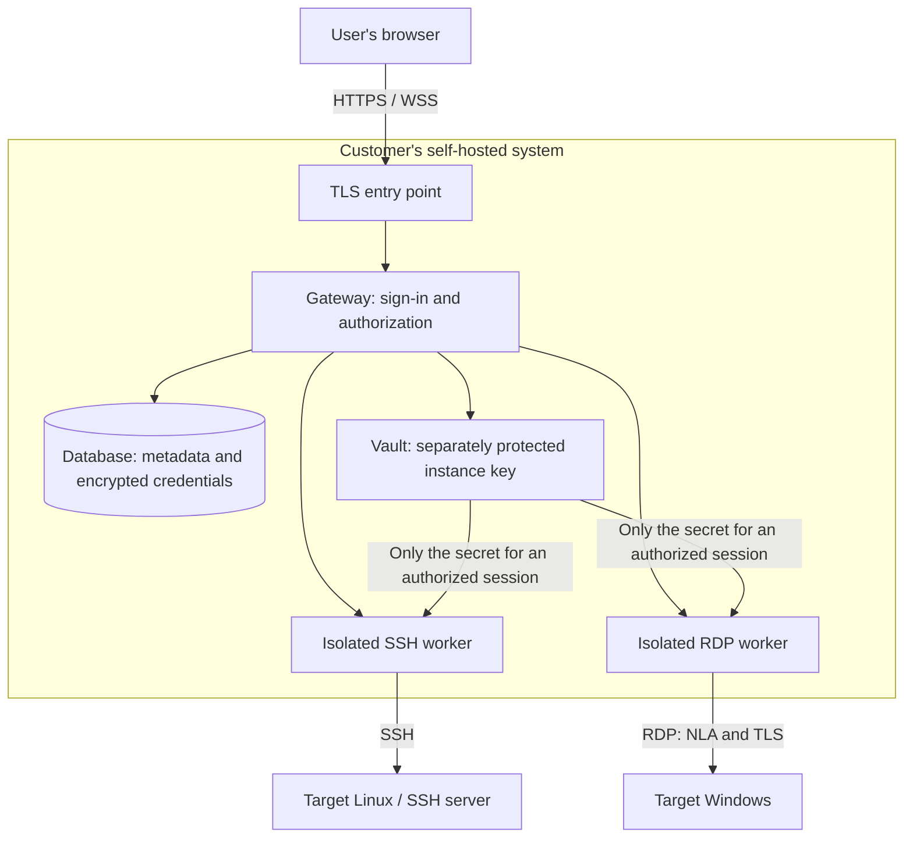

# Keybash — self-hosted SSH/RDP product plan

First written 12 October 2026 (Asia/Baku) as version 0.1, in Azerbaijani; this
English text replaces it as the canonical plan. Decisions taken since then are
marked with their date. Status of what exists today: `STATUS.md`.

## 1. Goal and agreed boundaries

Individuals and small teams keep their SSH keys and SSH/RDP accounts safely in
one place, connect to their servers from the browser, and do their daily work
comfortably.

Priority order: security → terminal/RDP comfort → breadth of features.
Comfort is designed together with the security decisions, not after them.

- The product is self-hosted only. No Denyfirst cloud account, relay or central
  credential store is required.
- The customer runs their own infrastructure, keys, backups and network egress.
- A browser is enough for daily use. The first server installation is an
  administrator's job.
- PAM approval, automatic account discovery and privileged credential rotation
  are out of scope.
- Porch and Rootwell are not changed; they are read only, when needed. Keybash
  is developed in its own folder and repository.
- Signing in grants access to the application; the backend still checks every
  operation. Hiding a page is never authorization.
- Visual direction: the Denyfirst family design. Since 30 October 2026 that is
  Schibsted Grotesk served by the gateway itself, Keybash's own signal cyan,
  light and dark schemes, readable text and visible keyboard focus. The UI is
  in English.

The stack, vault model, timeouts and stages below were initial proposals and
are revised by evidence. The boundaries above are the direction the maintainer
approved.

## 2. What it gives the user

It removes the question "where is my key, which account did I use, which
program do I open?".

The usual path: sign in with MFA → find or choose the server → Connect → work
in the terminal or on the desktop. Where security needs a server identity
check or extra authentication, the page says so in plain words.

Each account has its own connections and credentials. Since 1 November 2026
an instance has three roles, all managed from the web:

- **User:** reaches servers with their own keys and passwords.
- **Administrator:** a user who also invites, blocks, resets and deletes
  accounts and changes roles. An administrator never sees another person's
  password or their keys and passwords.
- **Auditor:** reads what happened; reaches no server and holds no secret.

Since 5 November 2026 administrators add SSH servers on the Servers page and
choose who may use each one; nobody can until they do, administrators
included (`adr/0005-web-managed-servers.md`). Planned next: the same access
lists for the servers in the operator catalog, an auditor's view of them, and
shared keys a user can connect with without seeing them. These need their own
design and review.

## 3. Third-party components and local operation

"Third-party code" and "an external service" are different things. Guacamole
and xterm.js are other projects' open-source code; Keybash ships them and runs
them on the customer's infrastructure.

| Component | Where it runs | Role |
|---|---|---|
| Keybash web pages | Served by the customer's server to the browser | Sign-in, connections, credentials and the workspace |
| xterm.js | In the user's browser | Draws the terminal and reads the keyboard; opens no SSH connection itself |
| SSH worker | On the customer's server | Opens the SSH connection and the remote PTY |
| Guacamole JS client | In the browser, from the local bundle | Protocol client for the RDP picture and input |
| Native RDP runtime | On the customer's server | Turns RDP into a stream the browser can draw |
| Gateway and vault | On the customer's server | Authentication, permissions, credential custody and sessions |
| Database | On the customer's server | Encrypted secrets and application metadata |

Keybash's own brand and interface are shown. Open-source licences and required
notices ship with the package, and every component's origin is documented
(`DEPENDENCIES.md`).

At runtime there is no external CDN, font, analytics, crash upload, cloud
authentication or licence check. Fetching packages at install or upgrade time
is separate from daily operation. Air-gapped operation may be claimed only
after a separate egress test.

## 4. Architecture

The browser never opens a TCP connection to a target. The self-hosted server
needs a network path to the targets: a LAN, the customer's VPN or their own
VPS. Keybash needs no cloud relay of its own and no agent on the targets, only
their existing SSH or RDP service.

The implemented stack, replacing the first candidates (TypeScript/React,
PostgreSQL, Docker Compose):

- a Go gateway and workers, with plain JavaScript modules for the pages;
- bbolt for local custody, with the instance key kept apart (15 October 2026,
  `adr/0004-durable-local-custody.md`);
- xterm.js in the browser, and a pinned, native Guacamole/FreeRDP runtime for
  RDP;
- native Linux systemd services with cgroup v2 limits (20 October 2026,
  `LINUX-SERVICE-LAB.md`).

SSH and RDP are never implemented from scratch. Guacamole's Java web
application is not used; the same authorization rules apply to both protocols.

## 5. Security model and trust boundary

Protected data: private keys, passphrases, remote passwords, MFA seeds,
recovery data, session tokens, connection metadata and terminal/RDP input and
output.

Trusted parts: the customer's host administrator, the Keybash gateway, vault
and session workers, the shipped program code, and the user's browser. Text
and protocol data from a target server is untrusted input.

The server-side gateway can use a credential to connect, and it processes
session data. Encrypting the database does not mean credentials stay safe
when the live host is fully compromised. This is not a zero-knowledge model.
A malicious browser extension and a fully compromised endpoint are outside the
trust boundary.

| Threat | Designed control | Remaining boundary |
|---|---|---|
| Stolen database or backup | Authenticated encryption, key kept apart from the database, encrypted backups | If the key is taken too, the protection is gone |
| Reaching another account's resources | Server-side ownership checks; separate credential and session permissions | No cryptographic isolation from the host administrator |
| Fake target server / MITM | SSH host key and RDP certificate verification | The first trust decision has to be right |
| XSS / session theft | CSP, local assets, safe DOM writes, server-side sessions | Untrusted browser extensions remain a risk |
| Unauthorized network reach | Registered targets, egress limits, checks at dial time | An authorized remote account keeps its own rights |
| Compromised protocol worker | Least privilege, sandbox, no access to the database or keys | A worker processes its own active session's data |

### Credentials and the vault

- Connections and credentials are separate objects. One credential may serve
  several authorized connections; changing a credential shows which
  connections it affects.
- Each record has its own random data key and is sealed with an AEAD cipher;
  the data keys are protected by a separate instance key. Only established
  cryptographic libraries are used; no home-made algorithms.
- A sealed record is bound to its owner, record and version, so a ciphertext
  moved to another record is refused. This is tested.
- The instance key is never kept in the repository, an image, the database or
  a database backup. It lives in its own restricted file, with a separate
  recovery copy.
- A worker cannot open the whole vault. It receives only the credential for
  its one authorized session. Plaintext secrets live as briefly as possible;
  erasure from RAM is not guaranteed.
- Secrets never go into URLs, process arguments, shared environment variables,
  the clipboard, logs or browser storage. Imports are checked in memory;
  writing a private key to a temporary file is not the normal path.
- Revealing a secret needs its owner and fresh authentication. By default the
  page shows a name, a type and a fingerprint.
- The sign-in password and remote passwords are different things. Sign-in
  passwords are stored with a modern password hash, never with reversible
  encryption.

### Sign-in and sessions

- Local accounts with a password plus TOTP MFA, and one-time recovery codes. No
  external e-mail or identity provider is needed for daily work.
- Passkeys are a later candidate; they are not required until relying-party,
  domain and backup questions are settled. TOTP is not claimed to resist
  phishing the way passkeys do.
- The first account is created only with a one-time secret given to the local
  administrator. There is no default password and no open registration.
- Secure, HttpOnly, SameSite cookies, CSRF protection, sign-in rate limits and
  protection against session fixation.
- The WebSocket upgrade checks authentication and the exact Origin. A session
  is bound to one user and connection; any ticket is short-lived, single-use
  and never carried in a URL.
- Every API checks permission. Active sockets also enforce expiry and
  revocation, not only the moment they open.
- Sign-out, deactivating a user and withdrawing a permission stop the worker.
  Acceptance target: the application session closes within 5 seconds of a
  revocation.
- Sessions end after 15 minutes idle and 8 hours at most. Continuous server
  output alone does not count as user activity.
- Closing the application connection does not guarantee every process on the
  target is killed; tmux, nohup and Windows disconnected sessions behave as
  they do.

### Reaching targets and isolating services

- An SSH host key is confirmed out of band on first use. A changed key is
  never accepted automatically; the connection is blocked until it is
  reviewed again.
- RDP uses NLA and TLS with certificate checks. A customer with their own CA
  can use it; a pinned-certificate trust model is used. Ignoring certificates
  wholesale is never the standard answer.
- LAN and private addresses are Keybash's main use and are not blocked as a
  class. Registered connections work within the hosts, ports and networks the
  administrator allowed.
- Cloud metadata, loopback, link-local and Keybash's own control services are
  refused by default. The DNS answer and the address actually dialled pass the
  same policy, including IPv4/IPv6 and rebinding.
- Workers never open a local shell on the host and never give users a host
  terminal. SSH uses a remote PTY.
- The RDP worker's port is never published; it is reachable only from the
  gateway.
- Minimal UIDs and capabilities, resource limits, timeouts and, where
  possible, a read-only filesystem. Sandbox and egress controls are tested on
  a real Linux deployment.

## 6. Terminal and RDP comfort

### SSH

Selection and copy, a paste shortcut, right click, scrollback, search, font
size, tabs, full screen, remote PTY resize and connection status.

Ctrl+C keeps stopping a command; copy is Ctrl+Shift+C, or the platform's own
rule, and the page says which. Tab, Ctrl+D, Esc, the arrows, vim, nano, htop,
tmux and non-Latin Unicode text are tested in a real shell.

A paste with several lines or control characters is shown for review first.
Bracketed paste is used correctly, but it is not claimed to stop unexpected
execution in every shell. No Enter is added to a paste.

Terminal titles, links and escape sequences are untrusted input. OSC clipboard
operations never change the local clipboard without a user action. Terminal
output is never rendered as HTML.

### RDP

Text copy and paste in both directions, resize, full screen, keyboard layout
choice and a panel for special keys.

With clipboard permission the copy is direct; without it, a plain local Copy
and Paste panel is used. Clipboard text goes only to the intended session,
never to every open tab. Keybash keeps no clipboard history and logs none. The
internal buffer is cleared when the session closes; the operating system's
clipboard history is not claimed to be cleared.

The browser and the operating system handle some shortcuts themselves. Files
and images through the clipboard, audio, printers, webcams and disk
redirection are not part of the first release.

Browsers: Chrome, Edge, Firefox and Safari, with Windows, macOS and Linux
keyboard differences. Testing may start on Chrome and Edge; full support
covers only a matrix that was actually measured. Managing connections is meant
to work on a phone; desktop-grade terminal and RDP comfort on a phone is a later
stage.

## 7. Features of the first working version

| Area | Covers |
|---|---|
| Connections | SSH/RDP, host, port, credential binding, RDP domain, folders, labels, favourites, search |
| Credentials | OpenSSH private key import, passphrase, password, key generation; fingerprint, name, affected connections |
| Workspace | SSH/RDP sessions, copy and paste, full screen, size, clear errors and disconnect |
| Account | MFA, recovery codes, password change, active sign-in sessions and their revocation |
| Backup | Encrypted backup, separate key recovery, restore to a clean system |
| Administration | Accounts and roles, target network policy, timeouts, an audit record and version information |

Imports and exports check format, size and ownership; error messages never
show secret content.

**Audit (decided 1 November 2026, not yet built):**
- Auditors and administrators read an append-only record of administrator
  actions and of who connected where and when.
- It also includes a readable log of the command lines typed in SSH sessions:
  each line as the screen showed it at Enter, so hidden input such as a sudo
  password is never recorded.
- There are no keystrokes, no terminal output, no clipboard content and no
  session video.
- Users are told that commands are recorded.
- The record is encrypted, hash-chained, size-capped and kept for a set time.
  It is not claimed to be immutable against the host administrator.

Later candidates: per-user server access and shared keys, SSH bastion or jump
host, an SFTP file panel, import from existing vaults, passkeys and wider
device support. None of them may delay the first version's security and
comfort checks.

## 8. Installation, upgrades and recovery

Installation is from source onto a fresh Linux host with systemd
(`INSTALL.md`). Server sizes and parallel session limits will be published
from load tests; no minimum RAM or CPU is promised yet.

Public-facing access is HTTPS only; a private CA or the customer's own
certificate gives local HTTPS. If a public CA or ACME is chosen, its outbound
network needs are stated. Internal ports are never published.

The package carries the web assets, protocol components and the runtime they
need. Versions are pinned. Signed releases, checksums, a dependency inventory
and upgrade instructions are prepared before the first release. An offline
package can be distributed separately; daily operation is tested without
internet access.

A backup covers the database, the metadata that must be kept, and the
version. The decryption key is kept apart; a backup never holds it. Restore
instructions cover moving the key and the instance identity safely
(`BACKUP-RESTORE.md`).

Sign-in recovery and vault-key recovery are different processes. Without a
recovery copy of a lost instance key, stored credentials cannot be opened
again; onboarding says so plainly.

Before an upgrade there is a backup. The limits of migrations and of going
back to an old version are documented; a single button that undoes every
migration is not promised. Nothing is uploaded to Denyfirst; a user may export
a redacted support bundle if they choose.

## 9. Stages and exit conditions

| Stage | Result | Exit condition |
|---|---|---|
| 0 — Plan | Product boundary, threat model, name | Self-hosting and the trust boundary are clear; open choices are listed |
| 1 — Technical trial | Minimal SSH and RDP in a lab, with test credentials only | Clipboard, keyboard, certificate and host-key checks and local operation are measured; the stack decision is written |
| 2 — Security foundation | Sign-in and MFA, vault, ownership, session lifecycle, worker isolation | Cross-account access and revocation tests pass |
| 3 — Product flow | Connections, credentials, terminal and RDP, Denyfirst design | Daily tasks are comfortable, with no security bypass |
| 4 — Self-host package | Install, upgrade, backup and restore, offline runtime | Install on a clean host and restore to a clean instance are verified |
| 5 — Release readiness | Security review, browser and load results, documented limits | Acceptance criteria pass; material open issues are closed or the release waits |

Stages are not dates. Security and UX are designed in parallel.

## 10. Acceptance criteria for a release

- User A cannot read, edit, export or connect with user B's connection,
  credential or session identifiers; reattaching a socket is tested too.
- Revocation and sign-out close the application session within the target. An
  expired token or ticket, or another origin, cannot open a socket.
- A changed SSH host key or an untrusted RDP certificate blocks the
  connection. A failed key check never falls back to a password silently.
- Test private keys and passwords are never found in plaintext in a database
  dump, a backup, logs, URLs or persistent browser storage. Secret canaries
  are used only in the lab.
- A worker cannot reach the database, a control endpoint or a container
  socket; DNS rebinding and actual-destination checks pass.
- On every supported browser, SSH and RDP text copy and paste, a refused
  permission and isolation between sessions are tested.
- vim, nano, tmux, htop, resize, Unicode and long output work in a real Linux
  shell. RDP keyboard layouts and the special-key path work.
- A clean self-hosted instance restored from an encrypted backup with its
  separate recovery key connects with a restored credential; a wrong key
  fails.
- During a runtime egress capture there is no contact with a vendor, CDN or
  analytics address; necessary queries to the customer's DNS and TLS
  infrastructure are listed.
- Parallel-session load, backpressure and worker-failure tests produce a
  published table of real resources and limits.
- No known exploitable critical or high issue remains in authentication, the
  vault, the protocols or the supply chain; a manual security review
  complements automated scanning.

Comfort will be measured on these tasks: adding a server, importing a key,
finding a connection, working with text in SSH, pasting both ways in RDP, and
restoring from a backup. The same tasks are compared with Apache Guacamole and
similar tools. Claims such as "no other product has this" or "the most
secure" are never made without evidence.

## 11. Open decisions

- Trademark clearance of the Keybash name.
- Per-user server access and shared keys: their design.
- Asking for a key's passphrase on every connection, as an option.
- When passkeys come.
- SSH bastion and SFTP.
- Server sizes and the official browser matrix.
- KB-05: whether to keep a monotonic counter outside the gateway owner's
  reach, so a rolled-back database record can be detected.

Production credentials are never used in technical trials.

## 12. Technical sources

Official documents read on 12 October 2026. The product decisions here are
ours; the sources ground the components' behaviour and security limits.

- [Guacamole architecture](https://guacamole.apache.org/doc/gug/guacamole-architecture.html)
- [Guacamole Docker: guacd isolation and its authentication boundary](https://guacamole.apache.org/doc/gug/guacamole-docker.html)
- [Guacamole configuration: SSH, RDP and clipboard](https://guacamole.apache.org/doc/gug/configuring-guacamole.html)
- [Guacamole clipboard limits](https://guacamole.apache.org/faq/)
- [xterm.js: a terminal component for the browser](https://xtermjs.org/)
- [xterm.js security guidance](https://xtermjs.org/docs/guides/security/)
- [Clipboard API: browser permissions and support](https://developer.mozilla.org/en-US/docs/Web/API/Clipboard_API)
- [OWASP Secrets Management](https://cheatsheetseries.owasp.org/cheatsheets/Secrets_Management_Cheat_Sheet.html)
- [OWASP WebSocket Security](https://cheatsheetseries.owasp.org/cheatsheets/WebSocket_Security_Cheat_Sheet.html)
- [Guacamole as open source](https://guacamole.apache.org/open-source/), [Apache 2.0](https://www.apache.org/licenses/LICENSE-2.0), [xterm.js MIT](https://github.com/xtermjs/xterm.js/blob/master/LICENSE)
